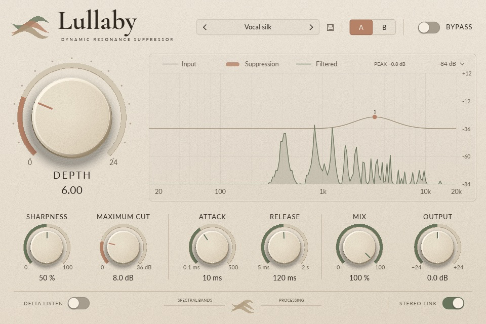

# Lullaby

A free audio effect that helps reduce harsh resonances in vocals, instruments,
and mixes. Use it in your favorite music production software.

**[Download Lullaby](https://github.com/amiran-gorgazjan/lullaby/releases/latest)**
· [Installation guide](docs/install.md)
· [Report an issue](https://github.com/amiran-gorgazjan/lullaby/issues)

| Your computer | Plugin formats |
| --- | --- |
| Windows (64-bit) | VST3, CLAP |
| macOS (Intel & Apple Silicon) | VST3, CLAP, Audio Unit |
| Linux (64-bit) | VST3, CLAP |

Download the ZIP for your computer, extract it, and follow the
[installation guide](docs/install.md). No payment, account, or activation required.

## Use

Start with **Gentle start** and adjust **Depth** until the reduction sounds right.
Use **Delta** to hear what is being removed, and **Mix** to blend the effect.

[More about the controls](docs/usage.md)

Free and open source under the [MIT license](LICENSE).
